# Fleet Console

Личный веб-интерфейс поверх [fleet](https://gitverse.ru/gigacode-ai/fleet): выбрать версию fleet, собрать прогон бенча
из пресета за несколько полей, увидеть заранее, что и где запустится, и довести прогон до замера — без ручной работы
в терминале. Работает локально на Mac (или на сервере с доступом в кластер), в браузере по адресу `http://127.0.0.1:8080`.

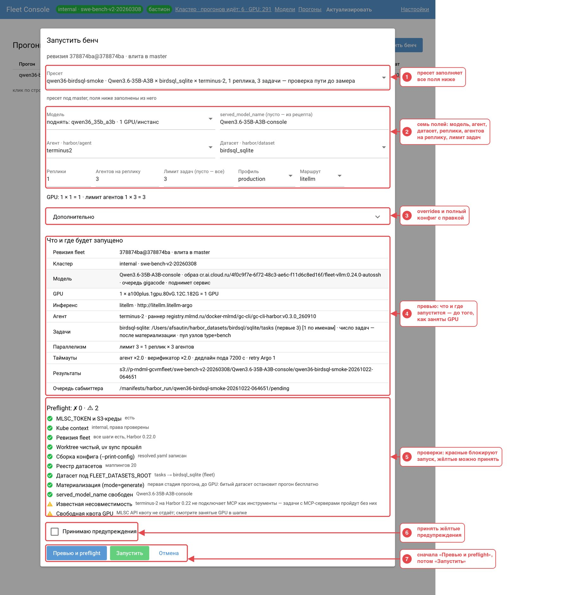

**Что умеет**

- запускать бенчи по стадиям и показывать каждую стадию: точную команду, код выхода, лог;
- поднимать модель без бенча, пробрасывать её на `localhost` и слать ей запросы из песочницы;
- показывать кластер: чьи прогоны идут, какие модели подняты, сколько GPU занято;
- останавливать свои прогоны, менять число реплик и лимит агентов;
- не давать Mac уснуть, пока идёт прогон, и предупреждать, если он всё-таки спал.

Подробное устройство — в [docs/ARCHITECTURE.md](docs/ARCHITECTURE.md). Этот README — о том, как пользоваться.

---

## Содержание

1. [Запуск за три шага](#запуск-за-три-шага)
2. [Что нужно положить заранее](#что-нужно-положить-заранее)
3. [Шапка: что означают чипы](#шапка-что-означают-чипы)
4. [Экраны](#экраны) — [Главная](#главная-ревизия-fleet) · [Кластер](#кластер) · [Модели](#модели) · [Прогоны](#прогоны) · [Настройки](#настройки)
5. [Типовые сценарии](#типовые-сценарии)
6. [Где что лежит](#где-что-лежит)
7. [Если что-то не так](#если-что-то-не-так)
8. [Словарик](#словарик)
9. [Для разработчиков](#для-разработчиков)

---

## Запуск за три шага

Нужны: macOS или Linux, [uv](https://docs.astral.sh/uv/), `git`, `kubectl`, ssh-доступ к бастиону кластера и к
`gitverse.ru` (см. [следующий раздел](#что-нужно-положить-заранее)).

**1. Установить и запустить**

```bash
git clone <адрес этого репозитория> fleet_ui && cd fleet_ui && uv run fleet-console
```

`uv run` сам создаст окружение и поставит зависимости. Сервис печатает адрес и ждёт — откройте в браузере:

```bash
open http://127.0.0.1:8080
```

**2. Дождаться подключения**

При первом запуске сервис сам:

- поднимает ssh-сессию к бастиону (чип «бастион» в шапке станет зелёным);
- клонирует зеркало репозитория fleet в `~/.fleet-console/fleet.git` (около минуты; в шапке будет написано
  «зеркала fleet ещё нет», потом появится время последнего fetch).

**3. Подготовить ревизию fleet**

На главной странице выберите ветку (обычно `master`) и нажмите **«Подготовить ревизию»**. Сервис создаст рабочую копию
этой версии fleet и соберёт каталог её конфигов. Первая подготовка ветки занимает минуты (ставится окружение fleet),
повторная — секунды. Без подготовленной ревизии формы «Запустить бенч» и «Поднять модель» не откроются.

Остановить сервис — `Ctrl+C` в терминале. Идущие прогоны при этом не теряются: после нового запуска сервис сверится
с кластером и продолжит их.

---

## Что нужно положить заранее

| Что | Где лежит | Зачем нужно |
| --- | --- | --- |
| ssh к бастиону | `~/.ssh/config`: хост `fleetbastion` с `LocalForward 8443` (API кластера) и `DynamicForward 1080` (SOCKS) | без него не работает `kubectl`, не ставится окружение fleet и не открывается Argo UI |
| ssh к gitverse | обычный ключ, `git clone git@gitverse.ru:…` должен работать | зеркало fleet и зависимости fleet по `git+ssh` |
| `MLSC_TOKEN` | файл `~/.fleet-console/secrets.env`, строка `MLSC_TOKEN=…` (или переменная окружения сервиса) | подъём и гашение моделей, карточка «Модели MLSC» на дашборде |
| ключи S3 | профиль `[gcvmfleet]` в `~/.aws/credentials` — им fleet пишет результаты; отдельный профиль только для чтения указывается в настройках («Профиль ключей S3») | загрузка результатов прогона, скачивание датасетов, список файлов в S3 |
| датасеты | каталог из настройки «Корень датасетов Harbor» (он же `FLEET_DATASETS_ROOT`) | задачи бенча; если каталога нет — preflight предложит «Скачать из S3» |

Секреты в логи и файлы прогона не попадают: сервис передаёт их только в окружение процессов fleet.

---

## Шапка: что означают чипы

Шапка одинаковая на всех страницах — по ней видно, подключён ли кластер и что сейчас идёт.

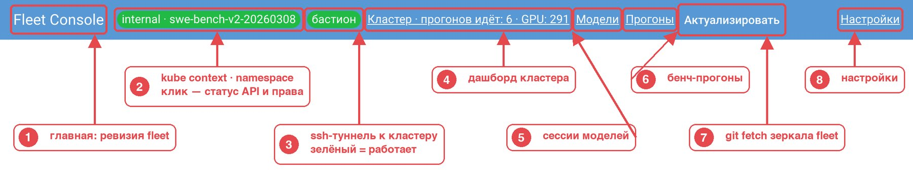

1. **Fleet Console** — ссылка на главную (выбор ревизии fleet).
2. **Чип с kube context и namespace** — куда смотрит `kubectl`. Зелёный — кластер отвечает и права проверены,
   красный — ошибка, серый — ещё не проверялось. Клик открывает подробности:

   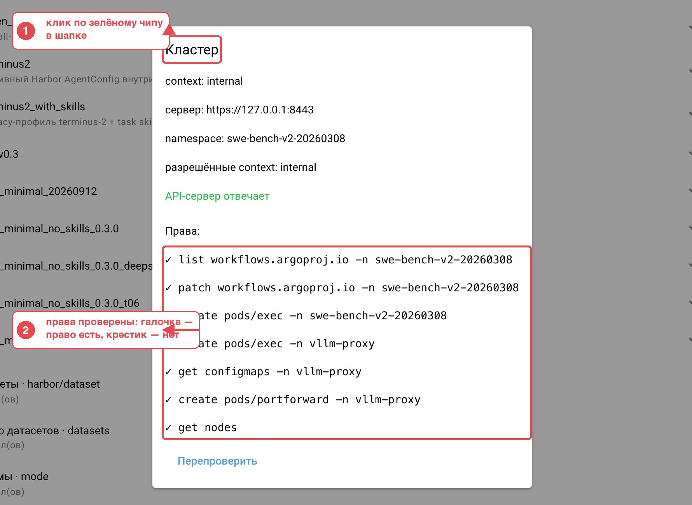

3. **Чип «бастион»** — ssh-сессия к кластеру. Зелёный — работает, жёлтый — переподключается, красный — упала.
   Клик показывает команду, последнюю ошибку и кнопку «Перезапустить». Это главный чип: без бастиона не работает ничего.
4. **Кластер** — дашборд; в самой ссылке видно, сколько прогонов идёт и сколько GPU занято.
5. **Модели** — сессии моделей, проброс порта, песочница.
6. **Прогоны** — бенч-прогоны; в ссылке видно, сколько идёт и сколько требуют внимания (⚠).
7. **Актуализировать** — подтянуть свежие ветки и коммиты fleet (`git fetch`). Рядом написано, когда это делалось
   в последний раз.
8. **Настройки**.

Другие чипы появляются по ситуации: **«шлюз litellm»** — пока открыт проброс порта к модели; **«без сна · N»** — пока
сервис не даёт Mac уснуть (N — сколько причин: идущие прогоны и сессии); **«батарея 42 %»** — Mac на батарее, запрет сна
слабее; **«Mac спал 25 мин»** — сводка, что случилось за это время (клик — подробности, «Понятно» — убрать).

---

## Экраны

### Главная: ревизия fleet

Здесь выбирается, какую версию fleet использовать. Прогон всегда закреплён за точным коммитом, даже если выбрана ветка.

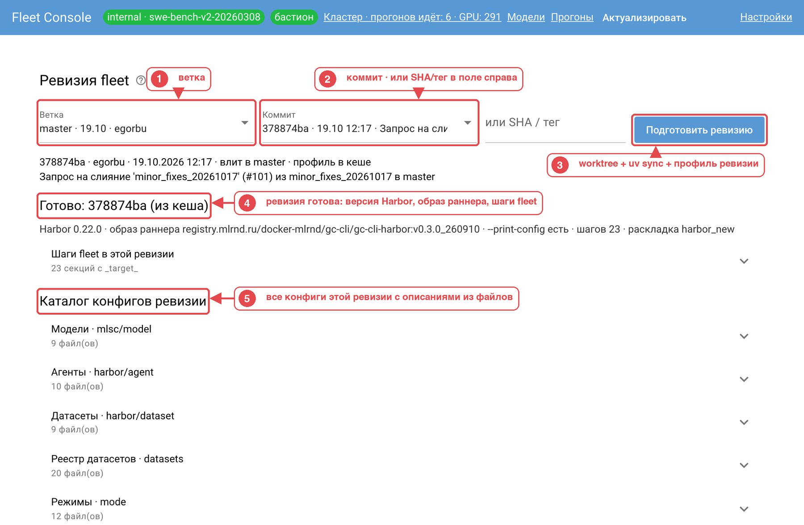

1. **Ветка** — список по дате последнего коммита, с автором.
2. **Коммит** — последние 50 коммитов ветки; можно вставить SHA или тег руками в поле справа.
3. **Подготовить ревизию** — сервис создаёт рабочую копию fleet на этом коммите (`~/.fleet-console/worktrees/<sha>`),
   ставит её окружение (`uv sync`) и собирает профиль: какие шаги и группы конфигов в ней есть.
4. **Готово** — ревизия готова; рядом версия Harbor, образ раннера и число шагов fleet. Если ревизия старая и в ней
   нет нужных шагов, здесь будет написано, почему она несовместима.
5. **Каталог конфигов ревизии** — все группы конфигов этой версии fleet: модели, агенты, датасеты, режимы и т. д.

Каждый файл в каталоге показан с описанием из его шапки, а по клику раскрывается целиком — удобно смотреть, что именно
значит тот или иной агент или рецепт модели:

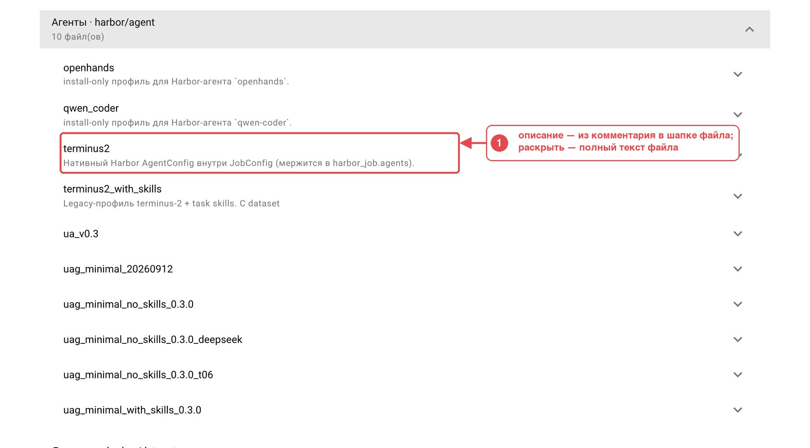

После перезапуска сервиса ревизия восстанавливается сама.

### Кластер

Дашборд только читает кластер и ничего в нём не меняет. Обновляется сам раз в 30 секунд.

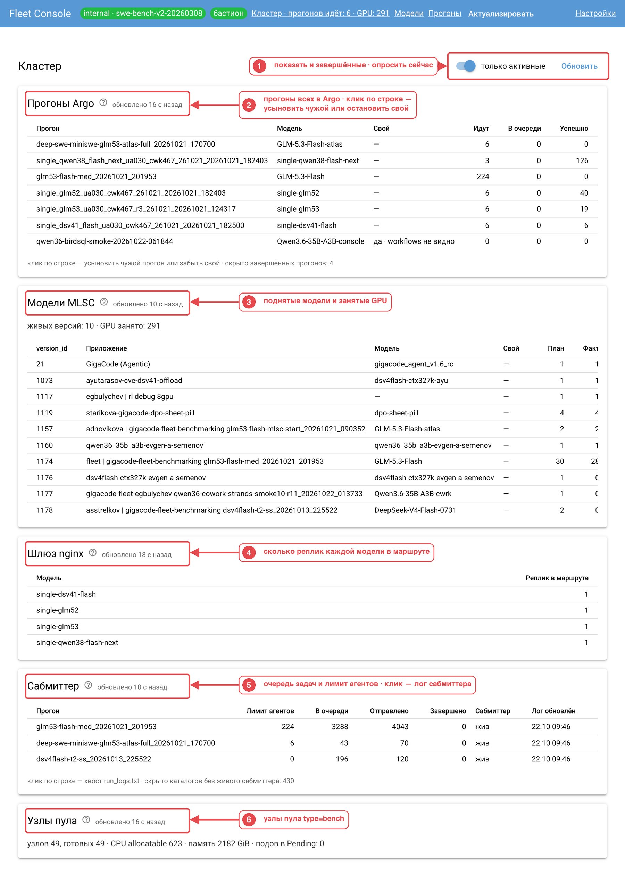

1. **«только активные»** — скрыть завершённые прогоны; **«Обновить»** — опросить кластер прямо сейчас.
2. **Прогоны Argo** — все прогоны в кластере: сколько задач идёт, ждёт и завершилось. Столбец «Свой» отмечает ваши.
   Клик по строке: чужой прогон можно **усыновить** (указать его `run_id` и версию модели — после этого им можно
   управлять), свой — остановить, поменять лимит агентов или число реплик.
3. **Модели MLSC** — все поднятые модели и занятые GPU (план и факт по репликам).
4. **Шлюз nginx** — сколько реплик каждой модели реально стоит в маршруте.
5. **Сабмиттер** — очередь задач по прогонам: лимит агентов, сколько в очереди, отправлено, завершено. Клик по строке —
   хвост лога сабмиттера.
6. **Узлы пула** — узлы, на которых идут задачи: сколько готово, сколько подов ждёт.

### Модели

Поднять модель без бенча, достучаться до неё с Mac и пострелять запросами.

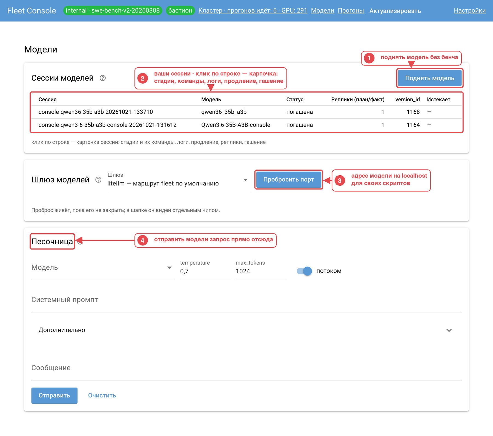

1. **Поднять модель** — форма новой сессии (ниже).
2. **Сессии моделей** — ваши сессии: статус, реплики, версия в MLSC, когда истекает. Клик по строке — карточка:
   стадии подъёма с командами и логами, **«Продлить +60 мин»**, смена числа реплик, **«Погасить»**.
3. **Шлюз моделей → «Пробросить порт»** — локальный адрес к шлюзу кластера; через него доступны все модели, которые
   шлюз видит, не только ваша.
4. **Песочница** — отправить запрос выбранной модели: системный промпт, сообщение, `temperature`, `max_tokens`,
   потоковый режим; в ответе — текст, reasoning (если модель его отдаёт), время до первого токена и токены.

**Форма «Поднять модель»:**

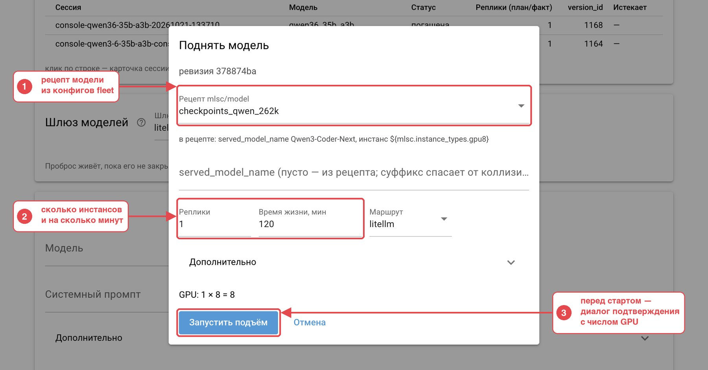

1. **Рецепт** — конфиг модели из группы `mlsc/model` выбранной ревизии fleet; ниже подсказка, какое имя и инстанс
   в нём заданы. Поле `served_model_name` можно оставить пустым — тогда имя из рецепта; суффикс (например `-console`)
   спасает от столкновений с чужой моделью с тем же именем.
2. **Реплики** и **время жизни** — сколько инстансов поднять и через сколько минут погасить автоматически (перед
   гашением — уведомление macOS и льготные 10 минут, в карточке можно продлить).
3. **Запустить подъём** — покажет сводку (модель, число GPU, стадии) и спросит подтверждение. Сессия идёт стадиями
   `create_job → start_llm → check_llm_works`, как в fleet.

**Шлюз после проброса:**

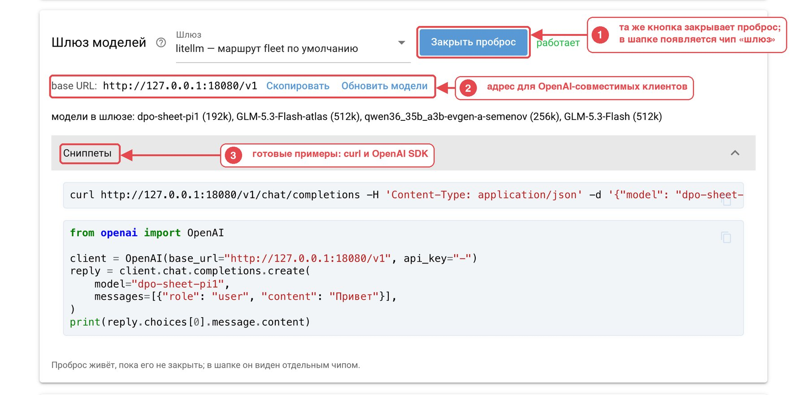

1. Кнопка меняется на **«Закрыть проброс»**; в шапке появляется чип «шлюз litellm». Проброс живёт, пока его не закрыть.
2. **base URL** вида `http://127.0.0.1:18080/v1` — подставляется в любой OpenAI-совместимый клиент. Рядом список
   моделей, которые видит шлюз.
3. **Сниппеты** — готовые примеры `curl` и Python (OpenAI SDK) с этим адресом и выбранной моделью.

### Прогоны

Главная рабочая страница: список ваших бенч-прогонов, форма запуска и карточка каждого прогона.

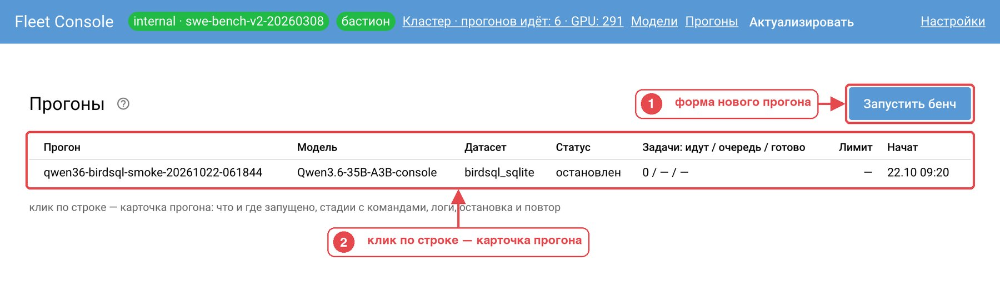

1. **Запустить бенч** — форма нового прогона.
2. Клик по строке — карточка прогона. Сверху таблицы появляется жёлтый баннер, если какой-то прогон требует внимания.

Путь прогона целиком:

```text
форма → «Превью и preflight» → «Запустить»
  → подготовка → материализация задач (ещё без GPU)
  → подъём модели → сабмит → исполнение (→ один раунд повтора упавших)
  → гашение модели → замер → готово
```

Сбой до подъёма модели ничего не стоит: прогон просто помечается неудачным. Сбой после — переводит прогон в состояние
«требует внимания»: GPU заняты, нужно решить, повторить стадию или погасить (см. [сценарии](#типовые-сценарии)).

#### Форма «Запустить бенч»


1. **Пресет** — готовый набор полей из `presets/*.yaml`. Выбрали — остальные поля заполнились; их можно поправить.
2. **Семь полей**: модель (поднять новую или взять уже поднятую сессию), имя модели, агент, датасет, реплики,
   агентов на реплику, лимит задач. Плюс профиль исполнения и маршрут инференса. Под полями считается, сколько GPU
   это займёт.
3. **Дополнительно** — любые overrides fleet (строками `ключ=значение`), блок `harbor_job` и кнопка **«Полный конфиг»**
   (ниже).
4. **Что и где будет запущено** — превью, собранное из итогового конфига fleet: образ модели, GPU, агент, путь
   к задачам, где будут результаты в S3. Всё это видно до того, как заняты GPU.
5. **Preflight** — проверки: токен и ключи, kube context и права, шаги ревизии, чистота рабочей копии, сборка конфига,
   реестр датасетов, наличие датасета на диске, занятость имени модели, известные несовместимости.
   Красные пункты блокируют запуск (у датасета есть кнопка **«Скачать из S3»**), жёлтые можно принять.
6. **Принимаю предупреждения** — появляется, только если есть жёлтые пункты.
7. **Превью и preflight** — собрать конфиг и прогнать проверки; **Запустить** становится активной только после
   зелёного списка и показывает сводку с подтверждением.

#### Полный конфиг

Открывается из «Дополнительно» после превью. Правки живут только в каталоге этого прогона — рабочая копия fleet не
меняется.

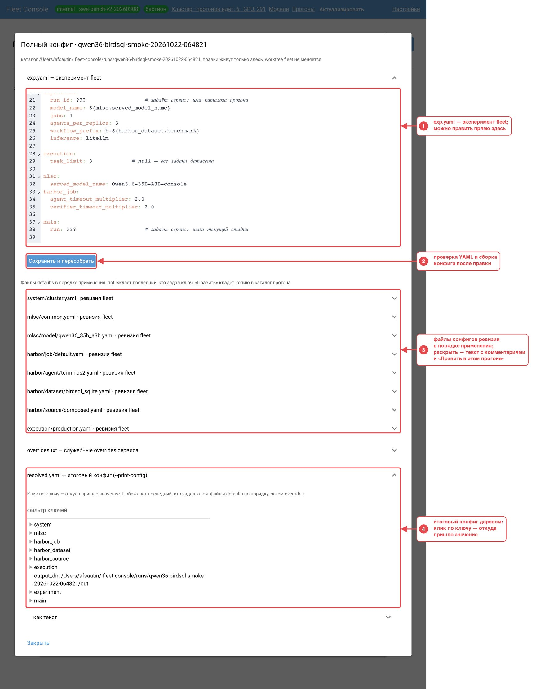

1. **exp.yaml** — эксперимент fleet в обычном виде, с редактором.
2. **Сохранить и пересобрать** — проверка YAML, пересборка конфига, превью пересчитывается.
3. **Файлы конфигов** в порядке применения (побеждает последний, кто задал ключ). Раскрыть — исходный текст
   с комментариями; **«Править в этом прогоне»** кладёт копию файла в каталог прогона; **«Сохранить в overlay»**
   переносит правку в репозиторий сервиса под новым именем, чтобы использовать в пресетах.
4. **resolved.yaml** — итоговый конфиг деревом с фильтром. Клик по ключу показывает, из какого файла и строки пришло
   значение, с комментариями вокруг.

#### Карточка прогона

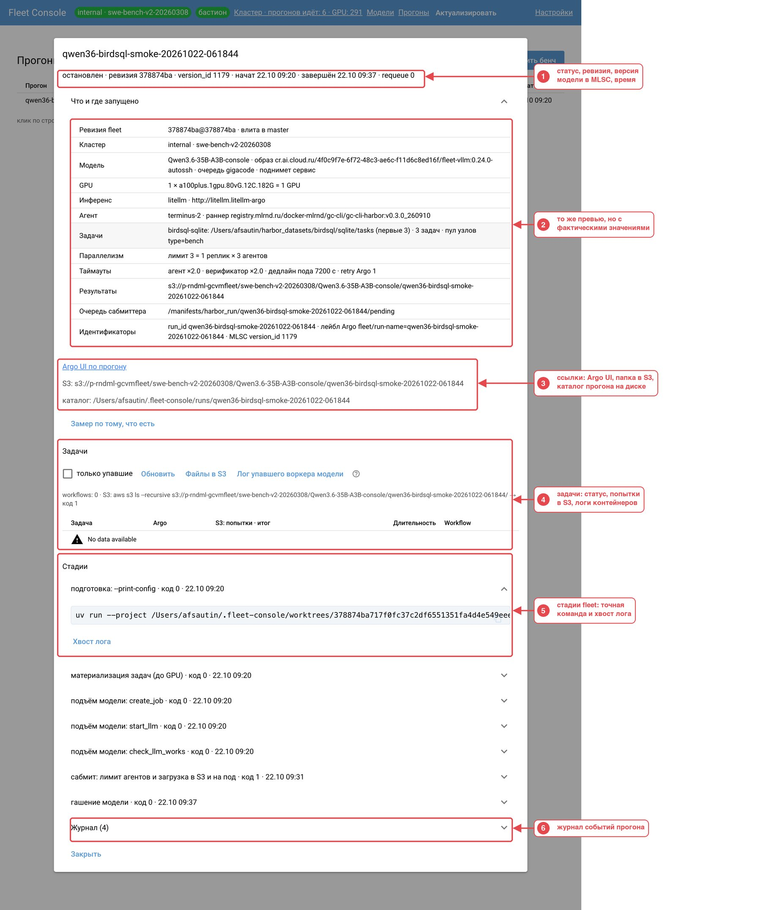

1. **Статус** и ключевые идентификаторы: ревизия, версия модели в MLSC, время начала и конца.
2. **Что и где запущено** — то же превью, но с фактическими значениями после запуска.
3. **Ссылки**: Argo UI с фильтром по прогону, папка результатов в S3, каталог прогона на диске.
   Для идущего прогона здесь же кнопки **«Остановить прогон»**, для требующего внимания — **«Повторить стадию»** и
   **«Погасить и остановить»**, для завершённого — **«Замер заново»**.
4. **Задачи** — таблица задач из Argo и S3: статус, попытки, итог, длительность; фильтр «только упавшие»;
   логи контейнеров идущей задачи, файлы последней попытки в S3, лог упавшего воркера модели.
5. **Стадии** — каждая стадия с кодом выхода и временем; раскрыть — точная команда (её можно скопировать и повторить
   в терминале) и **«Хвост лога»**.
6. **Журнал** — события прогона: переходы стадий, смена лимита и реплик, сон Mac.

### Настройки

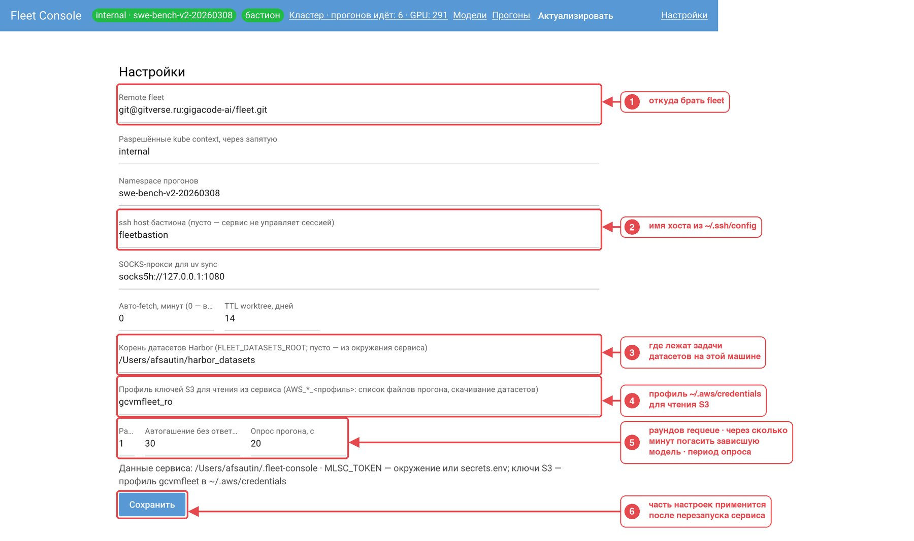

1. **Remote fleet** — откуда клонировать fleet.
2. **ssh host бастиона** — имя хоста из `~/.ssh/config`. Пусто — сервис сессией не управляет, только проверяет доступ.
3. **Корень датасетов** — каталог с задачами датасетов на этой машине.
4. **Профиль ключей S3 для чтения** — профиль из `~/.aws/credentials`, которым сервис читает S3 (список файлов,
   скачивание датасетов). Писать результаты fleet будет профилем `gcvmfleet`.
5. **Автогашение без ответа** — через сколько минут сервис сам погасит модель, если прогон требует внимания и никто
   не отреагировал (0 — не гасить). Рядом — число раундов повтора упавших задач и период опроса прогона.
6. **Сохранить** — пишет `~/.fleet-console/settings.yaml`. Remote, бастион и порт применяются после перезапуска сервиса.

---

## Типовые сценарии

### Запустить бенч

1. Главная → выбрать ветку и коммит → **«Подготовить ревизию»** (если уже готова — пропустить).
2. Прогоны → **«Запустить бенч»** → выбрать пресет (или заполнить поля руками).
3. **«Превью и preflight»** → прочитать «Что и где будет запущено», добиться зелёного списка проверок.
4. **«Запустить»** → проверить сводку → подтвердить.
5. Следить в карточке прогона; после замера итог появится в карточке и в Benchboard.

### Поднять модель и пострелять

1. Модели → **«Поднять модель»** → рецепт, реплики, время жизни → **«Запустить подъём»** → подтвердить.
2. Дождаться статуса «готова» в таблице сессий (подъём занимает 5–15 минут).
3. **«Пробросить порт»** → скопировать base URL или сниппет; в песочнице выбрать модель и отправить сообщение.
4. Закончили — в карточке сессии **«Погасить»** (или дождаться таймера). Проброс закрыть кнопкой.

### Бенч на уже поднятой модели

В форме «Запустить бенч» в поле **Модель** выберите «сессия: …». Стадии подъёма и гашения пропускаются, в конце бенч
модель не гасит, а таймер сессии на время бенча стоит.

### Прогон «требует внимания»

Красный баннер на странице «Прогоны» и уведомление macOS: модель поднята, GPU тратятся, а какая-то стадия упала.
В карточке: **«Повторить стадию»** — если причина устранена (например, кончился токен), **«Погасить и остановить»** —
если нет. Без ответа за N минут (настройка «Автогашение») сервис погасит модель сам.

### Остановить прогон

Карточка прогона → **«Остановить прогон»** → в диалоге видно, что будет затронуто (сколько задач, GPU). Сервис
выставит лимит агентов 0, остановит сабмиттер и задачи в Argo, погасит модель, если она принадлежит прогону,
и проверит результат.

### Перейти на другую ревизию fleet

**«Актуализировать»** в шапке → главная → выбрать ветку/коммит → **«Подготовить ревизию»**. Идущие прогоны остаются
на своих коммитах. Если в прогонах были ручные правки файлов, сохранённые в overlay, а в новой ревизии оригинал
изменился — preflight предупредит и покажет оба diff.

---

## Где что лежит

**Репозиторий сервиса**

```text
fleet_ui/
  presets/            # пресеты бенчей (YAML), версионируются в git
  overlay/configs/    # свои группы конфигов поверх fleet: агенты, модели, реестр датасетов
  known_issues.yaml   # известные несовместимости для preflight (например агент × версия Harbor)
  docs/ARCHITECTURE.md  # устройство и требования — источник правды
  docs/readme/        # картинки этого README и скрипты, которыми они сделаны
  src/fleet_console/  # код сервиса
  tests/              # тесты без кластера и без fleet
```

**Данные сервиса** — вне репозитория, в `~/.fleet-console/` (можно сменить переменной `FLEET_CONSOLE_HOME`):

```text
~/.fleet-console/
  settings.yaml       # настройки (то же, что страница «Настройки»)
  secrets.env         # MLSC_TOKEN=… и, при необходимости, ключи S3
  fleet.git/          # зеркало репозитория fleet
  worktrees/<sha>/    # рабочая копия fleet на каждый использованный коммит
  runs/<run_id>/      # каталог прогона или сессии модели:
    exp.yaml          #   эксперимент fleet
    overrides.txt     #   служебные overrides сервиса (одинаковые для всех стадий)
    resolved.yaml     #   итоговый конфиг (--print-config)
    fleet.sha         #   коммит fleet
    version_id        #   версия модели в MLSC
    registry/, out/   #   реестр датасетов и артефакты fleet
    logs/<стадия>.log #   лог каждой стадии
  logs/               # логи пробросов
  console.sqlite      # журнал прогонов, сессий и событий
```

Пресет — это маленький YAML, который ссылается на группы конфигов fleet по имени и задаёт только то, что отличается
от умолчаний. Пример — [presets/qwen36-birdsql-smoke.yaml](presets/qwen36-birdsql-smoke.yaml).

---

## Если что-то не так

| Симптом | Что это значит | Что делать |
| --- | --- | --- |
| Чип «бастион» красный или жёлтый | ssh-сессия к кластеру не поднялась или рвётся | клик по чипу — там ошибка и «Перезапустить»; проверьте `ssh -N fleetbastion` руками; VPN на Mac рвёт сессию |
| В шапке «зеркала fleet ещё нет» дольше нескольких минут | клонирование fleet не идёт | проверьте `ssh git@gitverse.ru`; при проблемах удалите `~/.fleet-console/fleet.git` — сервис склонирует заново |
| «Подготовить ревизию» работает минуты | ставится окружение fleet этой ревизии; для старых веток докачивается Python через SOCKS | подождать; повторная подготовка той же ревизии быстрая |
| Форма пишет «Сначала подготовьте совместимую ревизию» | ревизия не выбрана или в ней нет нужных шагов fleet | главная → выбрать ревизию → «Подготовить» |
| Preflight: красный «MLSC_TOKEN и S3-креды» | токена нет в `secrets.env` и окружении | положить `MLSC_TOKEN=…` в `~/.fleet-console/secrets.env`, перезапустить сервис |
| Preflight: красный «Датасет под FLEET_DATASETS_ROOT» | задач датасета нет на диске | кнопка «Скачать из S3» под пунктом (нужен профиль S3 со списком) или указать правильный корень в настройках |
| Preflight: красный «served_model_name занят» | модель с таким именем уже поднята кем-то | задать своё имя с суффиксом в поле `served_model_name` |
| Стадия «сабмит» упала с `AccessDenied` | ключ S3 в профиле `gcvmfleet` не имеет права записи | получить пишущий ключ и положить в `~/.aws/credentials` или `secrets.env` (`AWS_ACCESS_KEY_ID_gcvmfleet` / `AWS_SECRET_ACCESS_KEY_gcvmfleet`) |
| Прогон «требует внимания» | стадия упала, когда модель уже поднята | карточка → «Повторить стадию» или «Погасить и остановить»; без ответа сработает автогашение |
| Чип «Mac спал N мин» | пока Mac спал, сервис не следил за прогонами | клик — сводка, что изменилось; прогоны и пробросы уже сверены с кластером |
| Нужно посмотреть, что сервис делал | — | карточка прогона → стадии (команды и логи) и «Журнал»; логи пробросов в `~/.fleet-console/logs/` |

---

## Словарик

- **fleet** — инструмент команды для прогона бенчей: конфиги, шаги подъёма модели, сабмита задач и замера.
  Сервис его не меняет, только вызывает.
- **Ревизия** — конкретный коммит fleet. **Рабочая копия** (worktree) — каталог с этим коммитом и его окружением.
- **Пресет** — сохранённый набор полей формы запуска.
- **Overlay** — свои конфиги поверх конфигов fleet (агенты, рецепты моделей), живут в этом репозитории.
- **Preflight** — проверки перед запуском, до того как заняты GPU.
- **MLSC** — сервис кластера, который поднимает модели на GPU. **Версия** (`version_id`) — одна поднятая модель.
- **Шлюз** (litellm или nginx) — точка входа к моделям в кластере с OpenAI-совместимым API.
- **Argo** — система, которая исполняет задачи бенча в кластере; каждая задача — workflow.
- **Сабмиттер** — процесс в кластере, который по очереди отправляет задачи в Argo. **Лимит агентов** — сколько задач
  он держит одновременно.
- **Сессия модели** — модель, поднятая без бенча, с таймером жизни.
- **Усыновить прогон** — сказать сервису, что чужой по виду прогон в Argo на самом деле ваш, чтобы им управлять.

---

## Для разработчиков

```bash
uv run pytest          # тесты: без кластера, fleet и kubectl (всё внешнее — заглушки)
uv run ruff check      # линтер
```

Код лежит в `src/fleet_console/`, по модулю на компонент: `fleetref/` (зеркало и рабочие копии), `catalog/`
(каталог конфигов), `compose/` (сборка прогона, превью, preflight), `runs/` и `models/` (стадии прогонов и сессий),
`observe/` (чтение кластера), `connect/` (kube и пробросы), `guard/` (защита от сна), `ui/` (страницы NiceGUI).
Архитектура, фазы и открытые вопросы — в [docs/ARCHITECTURE.md](docs/ARCHITECTURE.md); грабли, найденные
по ходу, — в [CLAUDE.md](CLAUDE.md).

Картинки README собираются скриптами из `docs/readme/tools/` при запущенном сервисе:

```bash
uv run --with playwright --with pillow python docs/readme/tools/capture.py /tmp/shots
```

```bash
uv run --with playwright --with pillow python docs/readme/tools/figures.py docs/readme /tmp/shots
```

Первый снимает экраны установленным Chrome (кнопки, занимающие GPU, не нажимает), второй рисует рамки и стрелки.
