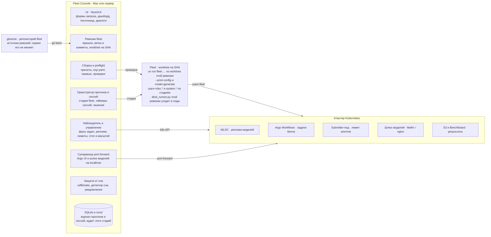
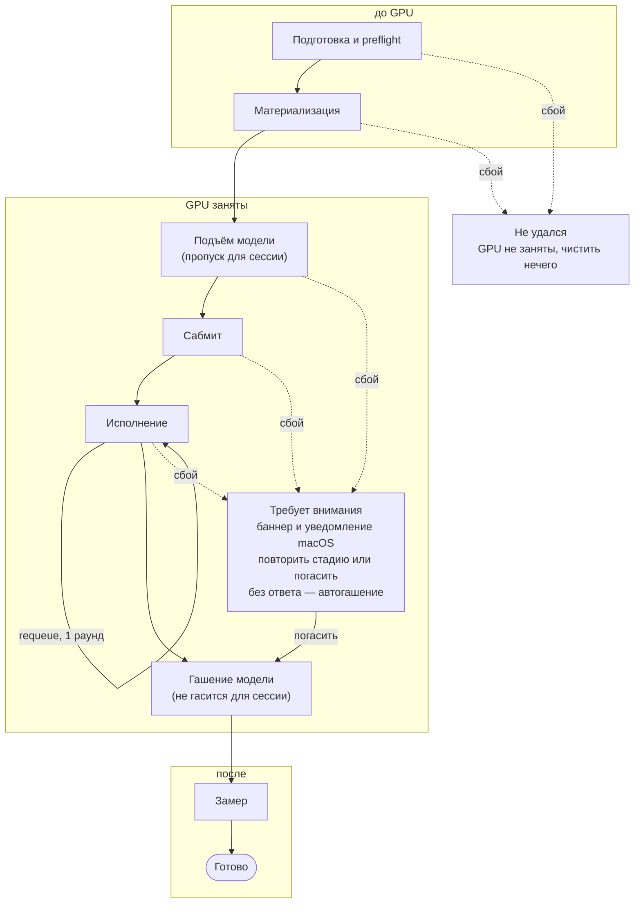

# Fleet Console — архитектура локального сервиса

Oct 21, 2026 · @Aleksandr

> Копия документа из Claude Docs (https://claude.ai/artifact/VbQcBno5fPyY7fvftv5S2i), выгружена 2026-10-21. Дальше источник правды — этот файл: правки вносятся здесь. Fleet Console — рабочее название; репозиторий — `fleet_ui`.

## Цель и рамки

Fleet Console — личный веб-интерфейс, который я поднимаю у себя на Mac или на сервере с доступом в кластер. Он позволяет выбрать ревизию fleet, собрать прогон из пресета за несколько полей, увидеть, что и где запустится, и довести прогон до замера без ручной работы в терминале.

**Входит:**

- выбор ветки и коммита fleet прямо из UI, с актуализацией в любой момент;
- каталог моделей, агентов и датасетов выбранной ревизии, свои пресеты и overlay-конфиги;
- полный доступ к конфигам: все файлы с комментариями, правка любого места с diff и проверкой;
- превью «что и где будет запущено» и preflight-проверки до выделения GPU;
- прозрачность запуска: карточка прогона — что, где и на каких ресурсах запущено, точные команды и все логи;
- запуск по стадиям с возобновлением после перезапуска сервиса;
- модель без бенча: поднять модель, пробросить порт на Mac, послать запросы из песочницы или своим кодом, потом пустить на ней бенч;
- обзор кластера: MLSC-джобы, прогоны Argo, лимиты агентов, узлы пула;
- управление своими прогонами: остановка, реплики, лимит агентов;
- защита от сна Mac и автоматическое подключение к кластеру.

**Не входит:**

- многопользовательский режим и деплой для других людей;
- изменения в коде fleet: сервис только читает его ревизии и вызывает его CLI;
- замена Argo UI, MLSC UI и Benchboard: на них ведут ссылки;
- собственный движок исполнения: все шаги прогона выполняет fleet.

**Принципы:**

1. Fleet — внешняя зависимость по ссылке (remote + SHA), а не копия кода.
2. Источник правды о состоянии — кластер, Argo, MLSC и S3. Сервис хранит только журнал своих запусков.
3. Прогон воспроизводим: SHA fleet + `exp.yaml` + список overrides лежат в каталоге прогона.
4. Модель не может остаться «забытой»: каждый сбой после подъёма модели ведёт к явному решению — погасить или продолжить.

## Сценарии использования

Пять сценариев покрывают всё, что сейчас делается руками через конфиги, `kubectl` и TUI.

| Сценарий | Что я делаю в UI | Что делает сервис |
| --- | --- | --- |
| Запуск бенча | Беру пресет или выбираю ревизию fleet, модель, агента, датасет, реплики и агентов на реплику; смотрю превью; жму «Запустить» | Собирает `exp.yaml`, гоняет preflight, ведёт прогон по стадиям до замера |
| Модель «пострелять» | Выбираю рецепт модели и число реплик, жму «Поднять», затем «Пробросить порт» | Поднимает модель через шаги fleet, ждёт готовности, даёт `localhost`-адрес OpenAI-совместимого API, песочницу и таймер автогашения |
| Обзор кластера | Открываю дашборд | Показывает MLSC-джобы, прогоны Argo с прогрессом, лимиты агентов и узлы пула; свои прогоны отдельно от чужих |
| Управление прогоном | Меняю число реплик или лимит, жму «Остановить» | Показывает, что именно будет затронуто, ждёт подтверждения, выполняет и проверяет результат |
| Смена ревизии fleet | Жму «Актуализировать», выбираю ветку и коммит | Делает fetch, готовит worktree на SHA, перестраивает каталог и показывает, какие пресеты с ней совместимы |
| Повтор прогона | Открываю прошлый прогон, жму «Повторить с правками» | Подставляет тот же SHA и параметры, показывает diff с исходным |

## Общая архитектура

Fleet Console — один локальный процесс: UI, шесть компонентов ядра и журнал в SQLite. Fleet он вызывает подпроцессом из worktree выбранной ревизии, а кластер читает напрямую.



Изменяет кластер напрямую сервис только в трёх местах: лимит агентов, остановка workflows и пробросы портов. Всё остальное — подъём и гашение моделей, загрузка в S3, сабмит и замер — делают шаги fleet.

## Fleet как ссылка

Сервис держит зеркало репозитория fleet и по одному git worktree на каждый используемый SHA. Прогон всегда закреплён за точным SHA, даже если в UI выбрана ветка.

**Как это работает:**

1. В настройках задаётся remote fleet (gitverse по ssh). При первом запуске сервис делает `git clone --mirror` в `~/.fleet-console/fleet.git`.
2. Кнопка «Актуализировать» выполняет `git fetch --prune` и показывает время последнего fetch. Авто-fetch по таймеру — опция, выключен по умолчанию.
3. В UI выбирается ветка (список по дате последнего коммита, с автором), затем коммит из последних 50 с сообщениями. Можно вставить SHA или тег руками.
4. Для выбранного SHA сервис создаёт `git worktree add --detach worktrees/<sha>` и выполняет там `uv sync --frozen`. Кеш uv общий, повторная синхронизация быстрая. Проверено 2026-10-21: `git clone --mirror` — 52 МБ; `git -C fleet.git worktree add --detach` из bare-зеркала работает, `status --porcelain` пуст; `uv.lock` есть во всех 87 ветках; `uv sync --frozen` на master — 24 с при тёплом кеше, `.venv` 578 МБ. Нужны ssh до `gitverse.ru:2222` (helpctl и benchboard — `git+ssh`, работает напрямую) и HTTPS до `pypi-mirror.gitverse.ru`, который из домашней сети отвечает только через SOCKS бастиона: `HTTPS_PROXY=socks5h://127.0.0.1:1080`. Python: в `pyproject.toml` fleet `python-preference = "only-managed"`, нужный 3.12 у uv уже установлен.
5. По worktree строится профиль возможностей ревизии (ниже) и каталог конфигов. Оба кешируются по SHA.
6. При запуске ветка разрешается в SHA, и этот SHA записывается в журнал прогона. Дальнейший fetch уже идущий прогон не затрагивает.

**Почему worktree, а не импорт библиотеки.** Зависимости fleet (harbor, benchboard, hera) остаются в его собственном venv и не конфликтуют с сервисом. Разные прогоны могут одновременно идти на разных ревизиях: например, один на `master`, другой на ветке со Strands. Все вызовы идут как `uv run --project worktrees/<sha> --no-sync fleet …` с cwd = worktree: fleet читает `dind_runner.py` и реестр датасетов по относительным путям (`--no-sync` обязателен, иначе `uv run` синхронизирует окружение на каждый вызов).

**Профиль возможностей ревизии.** Ревизии fleet расходятся (проверено по 87 веткам origin на 2026-10-21): у 61 ветки вообще нет каталога `examples/harbor_new/configs` — там старая раскладка `examples/harbor`; у 20 веток в `fleet/main.py` нет флага `--print-config`; наборы `mode/` отличаются (в 8 ветках нет `measure.yaml`, кое-где есть `retry_infra_tui.yaml` или `openrouter.yaml`); Harbor везде 0.22.0, кроме одной ветки с 0.23.0. Шага `ops.monitor` ни в одной ветке нет — монитор везде `mlsc.monitor`. Поэтому для каждого SHA сервис один раз собирает:

- списки групп: `mlsc/model`, `harbor/{job,agent,dataset,source,suite,jobs,additional_job}`, `execution/`, `mode/`, `system/`, а также реестр `datasets/` (это не Hydra-группа, а каталог `HarborDatasetRegistry.from_directory`) и корневые `config.yaml`, `experiment_template.yaml`, `exp_*.yaml`;
- какие секции-шаги существуют в итоговом конфиге: `--print-config` на `experiment_template.yaml` с первым элементом каждой обязательной группы и заглушками для `oc.env` (`FLEET_DATASETS_ROOT`, `MLSC_TOKEN`, `AWS_ACCESS_KEY_ID_gcvmfleet`, `AWS_SECRET_ACCESS_KEY_gcvmfleet`, `USER` — `resolve=True` без них падает); на master это 12 секций `system.*` и 10 `mlsc.*` с `_target_`, ~1.7 с;
- поддерживаемые флаги CLI (парсинг `fleet --help`; на master: `-w`, `-o`, `--tui/--no-tui`, `--argo-host`, `--force-stop-llm`, `--backend`, `--print-config`);
- версию Harbor из `pyproject.toml` и дефолтный `system.agent_image`.

Логические стадии сервиса мапятся на шаги, которые реально есть в ревизии. Нет нужного шага — пресет помечается несовместимым с этой ревизией, и UI объясняет почему.

**Что UI показывает о ревизии:** ветку и SHA, автора и дату, влита ли она в `master` и на сколько коммитов отстаёт от него, версию Harbor и образ раннера. Для пресета на плавающей ветке — предупреждение, если ветка ушла вперёд с момента последнего успешного прогона.

**Гигиена worktree:**

- сервис ничего не коммитит и не правит в worktree; перед запуском проверяет `git status --porcelain`;
- всё, что fleet пишет на диск (`output_dir`, `version_id_file`), перенаправляется в каталог прогона;
- worktree удаляется, если на нём нет активных прогонов и он не использовался N дней (N в настройках).

## Конфиги

Форма запуска показывает только семь полей: ревизия fleet, модель, агент, датасет, реплики, агенты на реплику и лимит задач. Всё остальное берётся из групп конфигов выбранной ревизии и из пресета; сырые overrides спрятаны в свёрнутом блоке «Дополнительно».

**Три источника конфигов:**

- **Каталог ревизии** — группы из `examples/harbor_new/configs` worktree. У каждого элемента UI показывает путь и шапку-комментарий файла: в fleet они содержательные. Проверено на master: шапки есть в `mlsc/model` (8 из 9), `harbor/agent` (10/10), `harbor/dataset` (9/9), `mode` (12/12), `execution` (2/2), но не в `datasets/` (0 из 20) — там UI показывает `benchmark` и `source.tasks_root` из тела файла. Строку директивы `# @package …` из шапки надо исключать.
- **Overlay сервиса** — свои группы в репозитории сервиса (`overlay/configs/...`): профили агентов вроде `terminus2_cowork`, рецепты моделей, маппинги датасетов вроде `cowork_bench_r10`. Имена не должны совпадать с именами из fleet — это проверяет preflight.
- **Пресеты** — YAML в `presets/`, версионированные в git сервиса. Пресет ссылается на группы по имени и задаёт только то, что отличается от дефолтов.

Пример пресета (схема предварительная):

```yaml
name: glm53flash-cowork-r10-terminus2
fleet:
  ref: master                 # ветка, тег или SHA
model: glm5.3-flash           # mlsc/model
agent: terminus2_cowork       # harbor/agent (из overlay)
dataset:
  path: cowork_bench_v2       # относительно FLEET_DATASETS_ROOT
  benchmark: cowork_bench
  mapping: cowork_bench_r10   # datasets/ (из overlay)
resources:
  jobs: 4
  agents_per_replica: 10
execution:
  profile: production
  task_limit: null
harbor_job:
  agent_timeout_multiplier: 2.0
  verifier_timeout_multiplier: 2.0
```

**Сборка прогона.** Из пресета и формы сервис пишет в каталог прогона `~/.fleet-console/runs/<run_id>/`:

- `exp.yaml` — обычный эксперимент fleet: список `defaults` и значения, без магии;
- `overrides.txt` — служебные overrides, одинаковые для всех стадий;
- `registry/` — объединённый реестр датасетов: `datasets/` ревизии + `datasets/` overlay, конфликт `tasks_root` = ошибка preflight;
- `resolved.yaml` — итоговый конфиг из `fleet --print-config`;
- `fleet.sha` — ревизия, на которой идёт прогон.

Служебные overrides и зачем они нужны:

| Override | Зачем |
| --- | --- |
| `hydra.searchpath=[file://<worktree>/examples/harbor_new/configs,file://<overlay>/configs]` | `exp.yaml` лежит вне fleet, а `defaults` должны находить группы ревизии и overlay |
| `experiment.run_id=<полный id>` | Без него fleet дописывает к run\_id новый timestamp на каждом вызове, и стадии перестают видеть друг друга |
| `output_dir=<run_dir>/out` | Артефакты не пишутся в worktree |
| `mlsc.version_id_file=<run_dir>/version_id` | Файл с id MLSC-приложения нужен для `start_llm`/`stop_llm`; он должен пережить перезапуск сервиса и чистку worktree |
| `system.materialize.dataset_registry.directory=<run_dir>/registry` | Объединённый реестр датасетов |
| `mlsc.pod_name=<текущий под>` | В fleet имя пода для MLSC захардкожено с хэшем ReplicaSet; сервис находит актуальный под сам |
| `main.run=[…]` | Сервис сам решает, какие шаги выполнить в стадии, и не зависит от файлов `mode/` ревизии |

**Превью «что и где».** Перед запуском UI показывает карточку, собранную из `resolved.yaml` и локальной материализации:

| Что | Откуда берётся |
| --- | --- |
| Ревизия fleet: ветка@SHA, влита ли в master | зеркало fleet |
| Кластер: kube context, namespace | kubeconfig, `system.namespace` |
| Модель: served name, образ, тип инстанса, очередь MLSC | `mlsc.create_job.job` |
| GPU всего: реплики × GPU на инстанс | `experiment.jobs` + тип инстанса |
| Инференс: litellm или nginx, base\_url gateway | `experiment.inference`, `system.polar.topology` |
| Агент и образ раннера | `harbor_job.agents`, `system.agent_image` |
| Задачи: число, S3-префикс | `mode=generate` в каталог прогона |
| Параллелизм: реплики × агенты на реплику | `experiment.*` |
| Результаты в S3 | `system.s3_base_directory` |
| Оценка GPU-часов | история прошлых прогонов; нет истории — «нет данных» |

**Preflight.** Кнопка «Запустить» активна только после зелёного списка; предупреждения можно принять явно.

- [ ] заданы `MLSC_TOKEN` и S3-креды;
- [ ] kube context в списке разрешённых, `kubectl auth can-i` на нужные действия;
- [ ] датасет есть под `FLEET_DATASETS_ROOT`, для него найден маппинг в реестре;
- [ ] `mode=generate` прошёл: все `task.toml` валидируются Harbor этой ревизии;
- [ ] worktree чистый, `uv sync` прошёл;
- [ ] `served_model_name` не занят чужим прогоном;
- [ ] известные несовместимости из `known_issues.yaml` сервиса: например, terminus-2 на Harbor 0.22 не подключает MCP как инструменты;
- [ ] свободная квота GPU — если MLSC API её отдаёт (открытый вопрос).

## Ручная правка конфигов

Форма — короткий путь, но в любой момент можно открыть полный конфиг прогона, увидеть все комментарии исходных файлов и поправить любое место. Правки никогда не пишутся в worktree fleet: они живут в каталоге прогона и попадают в его журнал.

| Уровень | Что видно | Что можно менять |
| --- | --- | --- |
| Форма | 7 ключевых полей с подсказками из шапок файлов | эти поля |
| Дополнительно | список overrides `ключ=значение` с автодополнением ключей из итогового конфига | любые overrides |
| Полный конфиг | дерево `defaults` в порядке применения: каждый файл ревизии и overlay с исходным текстом и комментариями; итоговый `resolved.yaml` | любой файл и сам `exp.yaml` |

**Комментарии.** Hydra при сборке теряет комментарии, а в конфигах fleet они часто важнее значений. Поэтому сервис показывает исходные файлы как есть, рядом с итоговым конфигом:

- шапки файлов видны в карточках каталога и в подсказках формы;
- клик по ключу в `resolved.yaml` показывает, откуда пришло значение: файл, строку, комментарии над ним и в строке, а для `${…}` — исходную интерполяцию;
- источник значения ищется проходом по `defaults` и overrides в порядке Hydra: побеждает последний, кто задал ключ. Для сложных случаев (`@package _global_`, списки) сервис показывает кандидата с пометкой «вероятно».

**Правка:**

1. Кнопка «Править» на файле группы кладёт копию в каталог прогона по тому же относительному пути (например, `runs/<id>/harbor/agent/terminus2.yaml`) и открывает редактор с подсветкой YAML.
2. Каталог прогона — основной каталог конфигов Hydra для `exp.yaml`, поэтому копия заменяет оригинал только в этом прогоне. Приоритет над `hydra.searchpath` проверить на прототипе.
3. При сохранении — проверка YAML, затем `--print-config`. Ошибка Hydra показывается рядом со строкой, превью «что и где» пересчитывается.
4. Diff с оригиналом ревизии виден всегда. Прогон с правками помечен «ручные правки» в списке и в карточке, а diff сохраняется в его журнале.
5. «Сохранить в overlay» переносит правку в репозиторий сервиса под новым именем, чтобы использовать её в пресетах.

При переходе на другую ревизию fleet сервис предупреждает, если оригинал правленного файла там изменился, и показывает трёхсторонний diff: исходная ревизия, новая ревизия, моя правка. Код fleet (`dind_runner.py`, Python) через редактор не правится: для этого есть своя ветка fleet и выбор её ревизии.

## Жизненный цикл прогона

Сервис ведёт прогон короткими вызовами fleet по стадиям, а долгое ожидание задач держит сам. Поэтому перезапуск сервиса или сон Mac не теряет прогон и не оставляет GPU висеть без контроля.



Стадии в зоне «GPU заняты» держат GPU: любой сбой там переводит прогон в «Требует внимания», а не в тихое падение. С сессией модели подъём и гашение пропускаются.

**Стадии бенч-прогона:**

| Стадия | Шаги fleet (`main.run`) | Где | Повтор после сбоя |
| --- | --- | --- | --- |
| 1. Подготовка | — (worktree, `uv sync`, сборка, `--print-config`, preflight) | локально | безопасен |
| 2. Материализация | `system.materialize`, `system.topology_saver`, `system.manifest_runner` | локально, до GPU | безопасен, перезаписывает `out/` |
| 3. Подъём модели | `mlsc.create_job`, `mlsc.start_llm`, `mlsc.check_llm_works` | MLSC | `create_job` не идемпотентен: если `version_id` уже записан, повтор начинается со `start_llm` |
| 4. Сабмит | `mlsc.create_agent_limit`, `system.runtime_upload`, `system.task_artifacts_upload`, `system.pod_upload`, `system.submitter_launch` | S3, submitter-под | upload безопасен; повторный `submitter_launch` — проверить, не стартует ли второй сабмиттер |
| 5. Исполнение | — (цикл сервиса) | сервис | возобновляется по журналу и состоянию Argo |
| 6. Requeue (опционально) | `system.requeue_failed`, `system.submitter_launch` | submitter-под | возврат в стадию 5 |
| 7. Гашение модели | `mlsc.stop_llm` | MLSC | безопасен |
| 8. Замер | `system.measure_run` | S3, Benchboard | безопасен |

Отличия от `mode=experiment` fleet:

- материализация идёт **до** подъёма модели: битый датасет или конфиг ловится до того, как заняты GPU;
- `mlsc.monitor` не вызывается: завершения задач ждёт сервис;
- `mlsc.autoscale_agents_start` не вызывается: лимит «живые реплики × агенты на реплику» пишет цикл сервиса. Два писателя одного файла лимита недопустимы;
- стадия 3 пропускается, а стадия 7 не гасит модель, если бенч запущен на уже поднятой сессии модели (следующий раздел).

**Исполнение стадий.** Каждая стадия — отдельный подпроцесс fleet в собственной группе процессов (`setsid`), с PID-файлом и логом `runs/<id>/logs/<stage>.log`. Код выхода определяет переход. Журнал в SQLite хранит стадию, время, код выхода, `version_id` MLSC и счётчики задач.

**Возобновление после перезапуска.** Для каждого незавершённого прогона сервис сначала сверяется с реальностью: состояние MLSC по `version_id`, фазы workflows в Argo, жив ли PID стадии. PID жив — сервис прицепляется к логу. PID мёртв — стадия повторяется по правилу из таблицы.

**Остановка прогона** (после диалога с числом workflows и GPU):

1. лимит агентов = 0, чтобы сабмиттер не слал новые задачи;
2. активные workflows прогона останавливаются (фильтр по `fleet/run-name`);
3. `mlsc.stop_llm`, если модель принадлежит этому прогону;
4. проверка: активных workflows 0, желаемых инстансов 0.

**Сбои.** Сбой до стадии 3 ничего не стоит: прогон просто помечается неудачным. Сбой после подъёма модели переводит прогон в «Требует внимания»: красный баннер «модель поднята, GPU тратятся», кнопки «Повторить стадию» и «Погасить», уведомление macOS. Если за N минут никто не отреагировал, сервис гасит модель сам (N и включение — в настройках).

## Модель без бенча и проброс порта

Fleet это позволяет: подъём и гашение модели — отдельные шаги (`mlsc.create_job`, `mlsc.start_llm`, `mlsc.check_llm_works`, `mlsc.stop_llm`), и их можно вызвать без бенча через `main.run`. В сервисе это отдельная сущность — **сессия модели**: у неё свой журнал, свой таймер, к ней можно пробросить порт и на ней можно запустить бенч.

**Подъём.** В форме: ревизия fleet, рецепт `mlsc/model`, `served_model_name` (из рецепта, с предложением личного суффикса против коллизий), число реплик, маршрут инференса (litellm по умолчанию или nginx) и время жизни. Стадии сессии:

1. **Подъём** — `mlsc.create_job`, `mlsc.start_llm`, `mlsc.check_llm_works`, с теми же правилами повтора, что в бенч-прогоне.
2. **Работа** — модель доступна, идёт таймер времени жизни с кнопкой «Продлить». Менять число реплик можно на лету.
3. **Гашение** — `mlsc.stop_llm` по кнопке или по истечении таймера: сначала уведомление macOS, затем льготный интервал, затем гашение.

**Проброс порта.** В кластере модель доступна через шлюз: litellm (`http://litellm.litellm-argo`, дефолт fleet) или nginx (`http://vllm-proxy.vllm-proxy:80`). По кнопке «Пробросить порт» сервис:

- поднимает `kubectl port-forward` к сервису шлюза на свободный локальный порт под тем же супервизором, что и для Argo (раздел «Подключение к кластеру»);
- проверяет `GET /v1/models`: если там нет `served_model_name`, предупреждает, что маршрут ещё не обновился или регистрация устарела — такая давала 404 на задачах в прошлых прогонах;
- показывает base URL `http://127.0.0.1:<порт>/v1`, имя модели и готовые сниппеты `curl` и OpenAI SDK для копирования;
- держит проброс, пока жива сессия или пока его не закрыли вручную.

Проброс работает для любой модели, которую видит шлюз, а не только для своей сессии. Прямой доступ к одной реплике в обход шлюза в первую версию не входит: реплики видны только через туннели на прокси-хост.

**Песочница.** Форма запроса к проброшенному шлюзу:

- системный промпт, сообщения, `temperature`, `max_tokens`, опционально `tools` в JSON, потоковый режим;
- в ответе: текст, reasoning (если модель его отдаёт), `tool_calls`, время до первого токена, общее время, токены;
- выбор модели из `/v1/models`;
- позже: короткая нагрузка «N запросов × M параллельно» с верхним пределом, чтобы прикинуть пропускную способность до бенча.

**Бенч на уже поднятой модели.** В форме бенча поле «Модель» предлагает два варианта: поднять новую или взять свою сессию. С сессией стадия подъёма пропускается, `experiment.model_name` и `experiment.jobs` берутся из сессии, а в конце бенч модель не гасит. Сессия знает, какие бенчи на ней идут, и не даст погасить себя под идущим бенчем без отдельного подтверждения. Таймер сессии на время бенча приостанавливается.

**Что проверить на прототипе:**

- [x] имена сервисов шлюзов (2026-10-21): litellm — `litellm-argo/service/litellm` (headless, 80; это и есть `http://litellm.litellm-argo` из `system/cluster.yaml`) и `litellm-argo/service/litellm-fleet` (ClusterIP, 80); nginx — сервиса `vllm-proxy` в namespace `vllm-proxy` нет, есть `vllm-proxy/service/nginx-vllm-proxy-test` (80; deployment `nginx-vllm-proxy` смасштабирован в 0, работает `-test`) и headless `argo/service/vllm-proxy` (80). Адрес `http://vllm-proxy.vllm-proxy:80` выше взят из `docs/REFACTORING_CONCEPTS.md` fleet и в кластере не подтверждён;
- [x] ключ litellm не нужен (2026-10-21, см. открытые вопросы);
- [x] из минимального `exp.yaml` без harbor-групп не собираются — подставляем заглушки (2026-10-21, см. открытые вопросы);
- [x] свои MLSC-приложения (2026-10-21): fleet сам дописывает к `application_name` префикс `$USER | ` (`fleet/create_job.py`, валидатор `Job.prefix_user`), в живом списке имена вида `asstrelkov | gigacode-fleet-egbulychev <run_id>`. Сервис передаёт `-o mlsc.create_job.job.application_name=fleet-console <run_id>` и `USER` владельца в окружении; свои версии узнаются по `run_id` в имени и по `version_id` из журнала.

## Прозрачность запуска

У каждого прогона и сессии модели есть карточка: что запущено, где, на каких ресурсах, какими командами, и все логи. За этим не нужно идти ни в `kubectl`, ни в консоль S3.

**Шапка карточки** видна всегда и совпадает с превью перед запуском, но с фактическими значениями. Пример — прогон GLM-5.3-Flash × cowork r10 из нашего разбора:

| Что | Пример |
| --- | --- |
| Ревизия fleet | `master@378874b`, влита |
| Кластер | kube context, namespace `swe-bench-v2-20260308` |
| Модель | `GLM-5.3-Flash`, образ `fleet-glm-5.3-flash:0.30.0`, очередь MLSC `gigacode` |
| Ресурсы модели | 4 × `a100plus.8gpu.80vG.96C.1456G` = 32 GPU; план, факт и число реплик в шлюзе |
| Инференс | litellm, `http://litellm.litellm-argo` |
| Агент | terminus-2, образ раннера `gc-cli-harbor:v0.3.0_260910` |
| Задачи | `cowork_bench_v2`, 496 задач, пул узлов `type=bench` |
| Параллелизм | лимит 40 = 4 реплики × 10 агентов; текущее значение файла лимита |
| Таймауты | множители агента и верификатора ×2, дедлайн пода |
| Результаты | `s3://p-rndml-gcvmfleet/swe-bench-v2-20260308/GLM-5.3-Flash/<run_id>` |
| Идентификаторы | `run_id`, MLSC `version_id`, лейбл Argo `fleet/run-name` |
| Стадия и время | текущая стадия, начало, длительность, GPU-часы по факту |

Под шапкой — живые счётчики задач: в очереди, идут, успешны, упали, результатов в S3. Дальше таблица задач с статусом, попыткой, длительностью и ссылками; фильтр «только упавшие».

**Точные команды.** Для каждой стадии карточка показывает команду целиком: cwd, `uv run --project … fleet runs/<id>/exp.yaml -o …` со всеми overrides, имена (не значения) переданных переменных окружения, код выхода и длительность. Команду можно скопировать и повторить в терминале — сервис ничего не делает невидимо. То же для прямых действий: запись лимита, остановка workflows, port-forward.

**Логи:**

| Лог | Откуда | Как смотрим |
| --- | --- | --- |
| Стадии fleet | stdout/stderr подпроцесса, `runs/<id>/logs/<stage>.log` | живой хвост, поиск, скачать |
| Модель | логи воркеров из MLSC API, как вкладка LLM в TUI fleet | хвост по реплике, лог упавшего воркера |
| Сабмиттер | `run_logs.txt` на submitter-поде | живой хвост |
| Задача, пока идёт | контейнеры workflow-пода: `dind_runner` и `dind-daemon` | живой хвост, ссылка в Argo UI |
| Задача, после завершения | S3: результаты и логи Harbor; в профиле `production` под удаляется сразу после завершения | просмотр файлов в UI |
| Действия и события | журнал SQLite | лента: переходы стадий, смена реплик и лимита, сон Mac, ручные правки |

**Ссылки из карточки:** Argo UI с фильтром по прогону, папка прогона в S3, Benchboard после замера, каталог прогона на диске (`exp.yaml`, `resolved.yaml`, diff ручных правок).

## Наблюдение за кластером

Дашборд только читает те же источники, что fleet и его TUI, и ничего в них не пишет. Слой чтения сервис пишет сам (кода там немного), чтобы не импортировать внутренности fleet.

| Источник | Что показываем | Как читаем |
| --- | --- | --- |
| Argo Workflows | прогоны и фазы задач (идут, успешно, упали), список упавших, ссылки в Argo UI | CRD `workflows.argoproj.io` через Kubernetes API по лейблу `fleet/run-name`; без port-forward |
| MLSC | приложения и версии, желаемые и фактические инстансы, лог упавшего воркера | `kubectl exec` в под деплоймента `litellm-noauth` в namespace `vllm-proxy`, как делает fleet, с `MLSC_TOKEN` |
| Шлюз nginx | сколько реплик модели реально в маршруте | ConfigMap `nginx-model-upstreams-runtime` |
| Submitter-под | лимит агентов, число манифестов в очереди, `run_logs.txt` | `kubectl exec` в `fleet-submitter-python` |
| Kubernetes | узлы пула `type=bench`, их allocatable, поды в Pending | Kubernetes API |
| S3 | сколько результатов уже лежит по прогону | листинг `s3_base_directory` по запросу |
| Benchboard | итог замера | ссылка; сервис `fleet/service/benchboard:80`, ingress нет — нужен port-forward |

**Свои и чужие.** Свои — прогоны и сессии из журнала сервиса: их `run_id`, `version_id` и префикс имени MLSC-приложения известны. Всё остальное — чужое и показывается только на чтение. Прогоны, запущенные до сервиса руками, можно «усыновить»: указать `run_id` и файл `version_id`, после чего ими можно управлять.

**Ресурсы.** Пока не подтверждено, что MLSC API отдаёт свободную квоту GPU по очереди `gigacode`. В fleet видно только состояние конкретных версий. Если квоты нет, дашборд показывает сумму GPU по известным приложениям: инстансы × GPU типа инстанса.

**Частота опроса** — настраиваемая. Активная страница опрашивается чаще, фоновые прогоны реже; S3 только по запросу.

## Подключение к кластеру

Сервис работает с моим kubeconfig и сам держит все нужные пробросы портов. Проверено 2026-10-21: сам API-сервер доступен только через ssh-сессию к бастиону. Kube context `internal` смотрит на `https://127.0.0.1:8443`, а этот порт открывает `ssh fleetbastion` из `~/.ssh/config` (`ProxyJump ecs3`, `LocalForward 8443 192.168.100.17:5443`, `DynamicForward 1080`). Та же сессия даёт SOCKS-прокси `127.0.0.1:1080`, без которого из домашней сети недоступны `pypi-mirror.gitverse.ru` (индекс по умолчанию в `pyproject.toml` fleet, нужен для `uv sync` worktree) и ingress-хосты `*.sberai-rnd.ru` (Argo UI). Поэтому ssh-сессия к бастиону — проброс №0 в супервизоре: принцип autossh применим именно к ней, а `kubectl port-forward` до Argo и шлюзов идут уже поверх неё через API-сервер.

**Kube context.** При старте сервис:

1. читает текущий context и сверяет его со списком разрешённых в настройках — чтобы не запустить прогон в чужой кластер (сейчас единственный context `internal`, кластер `internalCluster`, namespace в контексте не задан — берётся `system.namespace` = `swe-bench-v2-20260308`; сервер Kubernetes v1.33.5, локальный kubectl 1.37 предупреждает о version skew — безвредно);
2. делает `kubectl auth can-i` на нужные действия: чтение и patch workflows, exec в submitter-под и под MLSC, чтение ConfigMap, port-forward к сервисам (проверено: все нужные права есть, включая `delete workflows` и `create token`);
3. находит актуальный под для вызовов MLSC по деплойменту `litellm-noauth` в namespace `vllm-proxy`, а не по захардкоженному имени (в `mlsc/common.yaml` master записан `litellm-noauth-6588c4c7cf-sbhpg`; на 2026-10-21 он совпадает с живым подом);
4. постоянно показывает context и namespace в шапке UI. Протухший токен kubeconfig — понятная ошибка «переавторизуйтесь», а не красные таблицы.

**Супервизор пробросов.** Каждый проброс — запись с целью (namespace/service:port), локальным портом и проверкой здоровья:

| Проброс | Зачем | Проверка |
| --- | --- | --- |
| ssh-сессия к бастиону (`ssh -N fleetbastion`: API-сервер на 8443, SOCKS на 1080) | всё остальное: kubectl, `uv sync`, ingress-хосты | `kubectl get --raw /readyz` = `ok` |
| Argo Server (`-n argo service/argo-workflows-server`, 2746) — **пока не делаем** (решение 2026-10-21) | Argo UI; шагов fleet с Argo API сервис не вызывает | при надобности руками: `kubectl -n argo port-forward service/argo-workflows-server 2746`; API без токена отвечает 401 |
| Шлюз моделей litellm или nginx | песочница и свои скрипты к vLLM | `GET /v1/models` |

Процесс перезапускается, если он завершился, если проверка не прошла два раза подряд или если замечен выход Mac из сна. Пауза между попытками растёт экспоненциально до потолка. Статус каждого проброса виден в шапке: зелёный, жёлтый (переподключение) или красный.

Наблюдение за задачами идёт через Kubernetes API и от проброса до Argo не зависит. Упавший проброс ломает только Argo UI и песочницу, но не идущие прогоны. Упавшая ssh-сессия к бастиону ломает всё, поэтому её статус в шапке главный.

**Auth Argo.** Argo Server запущен с `--auth-mode=client`: и UI, и API требуют Bearer-токен Kubernetes; без него `/api/v1/version` отвечает 401, корень UI отдаёт 200. Fleet читает токен из `ARGO_TOKEN` (с префиксом `Bearer `), получить его можно командой `kubectl -n argo create token argo-server --duration 24h` (в `argo` есть и SA `argo-workflows-api-client-fleet` — какой из них нужен, вопрос Ф1). Namespace `swe-bench-v2-20260308` в README и шаблонах fleet для этого проброса указан ошибочно: там живёт только `workflow-controller`, сервер Argo — в namespace `argo`. Argo UI также доступен по ingress `https://fleet-argo.sberai-rnd.ru`, но только через SOCKS бастиона.

**Режим сервера.** На сервере сервис работает как systemd user unit или в tmux и слушает `127.0.0.1:8080`. С Mac к UI ходим через ssh-туннель, и вот здесь autossh как раз нужен: туннель переживёт смену Wi-Fi и сон ноутбука.

```bash
autossh -M 0 -N -o ServerAliveInterval=10 -o ServerAliveCountMax=3 -L 8080:127.0.0.1:8080 user@server
```

Прогоны при этом идут на сервере и не зависят от того, подключён ли Mac. Проброс шлюза моделей тоже поднимается на сервере. Чтобы стрелять в него с Mac, в тот же ssh-туннель добавляется второй `-L`; готовую команду UI показывает сам.

## Защита от сна Mac

Пока есть хотя бы один активный прогон или сессия модели, сервис не даёт Mac уснуть самому и предупреждает о случаях, которые программно не предотвратить.

**Как держим.** Сервис запускает `caffeinate -i -s -w <pid сервиса>`, когда появляется первый активный прогон, и снимает его, когда активных не осталось:

- `-i` запрещает сон по простою;
- `-s` запрещает системный сон, но только от сети;
- `-w` снимает запрет, если сам сервис упал, — висящего `caffeinate` не останется.

В шапке UI видно состояние: «Защита от сна включена: 2 активных прогона». Проверить снаружи можно через `pmset -g assertions`.

**Чего caffeinate не предотвратит:**

- закрытая крышка усыпляет Mac, если он не в режиме «закрытой крышки» с внешним дисплеем и питанием;
- разряд батареи;
- сон или выключение вручную.

**Предупреждения:**

- перед запуском долгого прогона на Mac — диалог «Прогон займёт несколько часов: не закрывайте крышку или запустите на сервере»;
- на батарее (проверка через `pmset -g batt`) — жёлтый баннер: «Без питания запрет сна слабее; подключите зарядку»;
- при низком заряде — уведомление macOS с кнопкой «Погасить модели».

**Что происходит во время сна.** В кластере всё продолжается: workflows, сабмиттер на поде, модель. Останавливаются только циклы сервиса: пересчёт лимита, таймеры жизни сессий, автогашение. Значит, пока Mac спит, модель никто не погасит. Для прогонов без присмотра надёжнее режим сервера.

**После пробуждения.** Цикл сервиса пишет метки времени; большой разрыв между ними означает сон. Тогда сервис заново поднимает пробросы, сверяет все прогоны с кластером и показывает сводку: «Mac спал 47 минут; за это время завершилось 120 задач, сессия X просрочена — погасить?». Цифры в примере условные.

На Linux-сервере защита не нужна; если это десктоп, можно включить `systemd-inhibit`.

## Безопасность и секреты

Даже для личного инструмента сервис держит токены и может гасить модели, поэтому он закрыт от сети и не делает ничего разрушительного без подтверждения.

- **Сеть.** UI слушает только `127.0.0.1`; доступ с другой машины — только через ssh-туннель. Авторизации нет и не нужно.
- **Секреты.** `MLSC_TOKEN`, S3-ключи, `ARGO_TOKEN` хранятся в macOS Keychain (через `keyring`) или в `.env` с правами `600` вне git. В fleet они передаются только через окружение подпроцесса: fleet читает их через `oc.env`, и в `exp.yaml` или `resolved.yaml` они не попадают.
- **Логи.** Известные секреты вырезаются из логов стадий до записи на диск и показа в UI. Сервис проверяет `resolved.yaml` на случайные значения секретов — `--print-config` разрешает `oc.env`.
- **Разрушительные действия** (остановка прогона, гашение модели, снижение реплик) — только для своих объектов и только после диалога со сводкой: что именно и сколько GPU и задач будет затронуто.
- **Аудит.** Каждое действие, меняющее состояние кластера, пишется в SQLite: время, действие, объект, результат.
- **Кластер.** Запуск и управление работают только в разрешённых kube context и namespace из настроек.

## Стек и структура репозитория

Целиком Python: тот же язык, что у fleet, и никакой сборки фронтенда.

| Что | Выбор | Почему |
| --- | --- | --- |
| UI | NiceGUI | формы, таблицы, диалоги и живое обновление по websocket на чистом Python; 3.18.0 с PyPI (PyPI с Mac доступен напрямую, зеркало gitverse сервису не нужно) |
| Фоновые циклы | asyncio в том же процессе | один процесс, без очередей и брокеров |
| Хранилище | SQLite | журнал прогонов, сессий, аудита в одном файле |
| Kubernetes | `kubectl` на всё: чтение через `-o jsonpath`, exec, port-forward (решено на Ф1) | один механизм и одна подмена в тестах (FakeRunner); узкий jsonpath, как у submitter fleet, не тянет мегабайты `status.nodes`; клиент `kubernetes` не понадобился |
| Git | git CLI | mirror, fetch, worktree — проще и надёжнее обёрток |
| Fleet | подпроцесс `uv run --project <worktree> fleet` | изоляция зависимостей и любая ревизия |
| Секреты | `keyring` | macOS Keychain без файлов с токенами |
| Упаковка | uv, запуск `uv run fleet-console` | как в fleet |

Структура репозитория сервиса:

```text
fleet-console/
  pyproject.toml
  src/fleet_console/
    app.py           # страницы NiceGUI
    settings.py      # remote fleet, разрешённые contexts, таймеры
    fleetref/        # зеркало, ветки и коммиты, worktree, uv sync, профиль возможностей
    catalog/         # группы конфигов ревизии + overlay
    presets/         # загрузка и валидация пресетов
    compose/         # exp.yaml, overrides, реестр датасетов, превью, preflight
    runs/            # машина состояний, стадии, подпроцессы fleet
    models/          # сессии моделей, таймеры, песочница
    observe/         # Argo, MLSC, nginx, submitter, k8s, S3
    connect/         # kube context, супервизор port-forward
    guard/           # caffeinate, детектор сна, уведомления
    store/           # SQLite
  presets/*.yaml
  overlay/configs/   # свои harbor/agent, mlsc/model, datasets
  known_issues.yaml  # известные несовместимости для preflight
  tests/
```

Данные сервиса лежат вне репозитория:

```text
~/.fleet-console/
  fleet.git/                  # зеркало fleet
  worktrees/<sha>/            # по одному на ревизию
  runs/<run_id>/              # exp.yaml, overrides.txt, resolved.yaml, fleet.sha,
                              # version_id, registry/, out/, logs/
  console.sqlite
```

**Тесты против fleet.** Ночная проверка берёт свежий `master` fleet и прогоняет все пресеты через сборку, `--print-config` и `mode=generate` на одной задаче. О том, что fleet сломал пресет, узнаю утром, а не на запуске.

## Фазы и критерии готовности

Пять фаз, каждая заканчивается проверкой на живом кластере. Модели и управление идут раньше запуска бенчей: это проще и сразу даёт поднять модель и пострелять в неё.

| Фаза | Оценка | Что входит | Гейт |
| --- | --- | --- | --- |
| Ф0 · Каркас | несколько дней | репозиторий, настройки, SQLite, запуск `uv run fleet-console`; kube context и супервизор port-forward; зеркало fleet, ветки и коммиты, worktree, `uv sync`, профиль ревизии | в UI выбираю ветку и коммит и вижу каталог ревизии с комментариями |
| Ф1 · Обзор кластера | несколько дней | дашборд: MLSC, Argo, submitter, шлюзы, узлы пула; свои и чужие прогоны, усыновление ручных прогонов | цифры дашборда совпадают с `kubectl` и Argo UI |
| Ф2 · Модели и управление | около недели | сессии моделей: подъём, таймер, гашение; port-forward к шлюзу моделей и песочница; стоп прогона, реплики, лимит агентов; защита от сна | поднял модель, пострелял из песочницы, погасил из UI — GPU свободны |
| Ф3 · Запуск бенчей | 1–2 недели | пресеты, форма, overlay, ручная правка конфигов с комментариями; превью «что и где» и preflight; стадии с возобновлением, бенч на сессии модели; карточка прогона, точные команды, все логи | smoke на 3 задачах от кнопки до замера; перезапуск сервиса посреди прогона его не ломает |
| Ф4 · История | по желанию | повтор с правками, diff прогонов; ночная проверка пресетов, скачивание датасетов из S3 | — |

Оценки ориентировочные, для одного человека. Открытые вопросы из следующего раздела закрываются до начала фазы, которой они касаются.

**Статус:** Ф0 выполнена 2026-10-21 (ветка `phase-0`, 48 тестов без кластера); гейт проверен на живом кластере: сервис сам поднял ssh к бастиону и проброс Argo, склонировал зеркало, подготовил `master` и показал каталог с шапками; ветка без `harbor_new` помечена несовместимой. 

**Ф1 в работе** (2026-10-21, ветка `phase-1`): страница «Кластер» читает Argo (workflows по `fleet/run-name`), шлюз nginx, submitter-под и узлы пула; цифры сверены с `kubectl` на живом кластере (8 активных прогонов, 49/49 узлов, реплики в маршруте 12/1/1/1, лимит агентов на поде = числу идущих workflows). Карточка MLSC ждёт `MLSC_TOKEN` (окружение сервиса или `~/.fleet-console/secrets.env`). Усыновление ручных прогонов сделано: таблица `runs` в SQLite, клик по строке прогона — «Усыновить» (run_id, version_id MLSC, заметка) или «Забыть», метка «Свой» в таблицах Argo и MLSC; проверено на живом кластере. Карточка MLSC проверена 2026-10-21: первый токен API не знал (одинаковый 401 с ним и без него, запрос сервиса совпадает с `fleet/mlsc.py` и `scripts/mlsc_queue.py`), со вторым токеном владельца карточка показывает те же 10 живых версий и 245 GPU, что `get_configuration` напрямую. Токен лежит в `~/.fleet-console/secrets.env`. Не сделано: сверка с Argo UI (нужен токен). Попутно: под VPN на Mac ssh к бастиону рвётся.

**Ф2 в работе** (2026-10-21, ветка `phase-2`). Сделано и покрыто тестами без кластера: проброс к шлюзу моделей под супервизором (litellm или nginx, проверка `GET /v1/models`, base URL и сниппеты curl/OpenAI SDK) и песочница (поток, reasoning, tool_calls, время до первого токена, usage) на странице «Модели»; защита от сна (`caffeinate -i -s -w <pid>`, пока идут свои прогоны или живут сессии; батарея в шапке); для своих прогонов — лимит агентов, реплики модели и остановка (лимит 0 → убить сабмиттер → Terminate активным workflows → проверка → модель, если своя) через диалоги со сводкой и журналом команд; сессии моделей (preflight `--print-config` → `mlsc.create_job` → `mlsc.start_llm` → `mlsc.check_llm_works` отдельными подпроцессами fleet из worktree, конфиг сессии — копия `overlay/configs/console_model.yaml` в каталоге `~/.fleet-console/runs/<id>/` с группами ревизии через `hydra.searchpath`; таймер жизни с уведомлением macOS и льготным интервалом, продление, реплики на лету, возобновление после перезапуска, карточка со стадиями, командами и логами). Проверено на живом кластере: проброс и список моделей litellm, caffeinate (`pmset -g assertions`), диалоги управления усыновлённым прогоном (лимит и версия MLSC подтянулись), форма сессии со сводкой GPU. **Гейт Ф2 пройден 2026-10-21 с согласия владельца:** из UI поднята сессия `qwen36_35b_a3b` (1 реплика, 1 GPU, `served_model_name` с суффиксом `-console`): preflight, `mlsc.create_job` (версия 1164), `mlsc.start_llm`, `mlsc.check_llm_works` — все с кодом 0, модель появилась в litellm `/v1/models`; из песочницы через проброс получен ответ (до первого токена 486 мс, всего 4,8 с, 598 токенов с reasoning); «Погасить» выполнил `mlsc.stop_llm` с кодом 0, через минуту версия 1164 исчезла из `application_version_states` — GPU свободен. Каталог сессии с командами и логами: `~/.fleet-console/runs/console-qwen3-6-35b-a3b-console-20261021-131612/`. **Не проверено на живом прогоне:** запись лимита агентов, Terminate workflows, смена реплик у усыновлённого прогона. Отступления от текста выше: для усыновлённых прогонов гашение и реплики идут прямым `set_planned_state` (то же, что `fleet.mlsc.SetInstances`), без worktree; в остановку прогона добавлен шаг «убить сабмиттер», потому что лимит 0 — только пауза.

## Риски и открытые вопросы

Главный риск — fleet меняется без оглядки на сервис, а поддерживаю сервис я один. Поэтому связь с fleet минимальна: CLI, группы конфигов и закреплённый SHA.

| Риск | Чем опасен | Что делаем |
| --- | --- | --- |
| Fleet меняет имена шагов, флаги CLI, правило суффикса run\_id | пресеты ломаются на новой ревизии | профиль возможностей, ночная проверка, прогон всегда на точном SHA |
| ~~Override `main.run=[…]` со списком не сработает~~ (работает, проверено 2026-10-21) | — | запасной путь остаётся: файлы `mode/console_<стадия>.yaml` в overlay |
| Потерян `version_id` после `create_job` | MLSC-приложение-«сирота» жжёт GPU | `version_id` сразу в каталог прогона и в SQLite; дашборд показывает приложения со своим префиксом без прогона |
| Mac спит с поднятой моделью | модель никто не гасит | защита от сна, предупреждения, режим сервера для прогонов без присмотра |
| Имя пода MLSC захардкожено в fleet с хэшем ReplicaSet | все вызовы MLSC падают после редеплоя | сервис находит под сам и передаёт `mlsc.pod_name` |
| Два писателя лимита агентов (сервис и autoscale или TUI fleet) | лимит «флапает» | сервис не вызывает шаги autoscale; TUI fleet для этих прогонов не запускать |
| Задачи датасета есть только у кого-то локально | материализация невозможна | функция «Скачать датасет из S3», если зеркало подходит (вопрос ниже) |
| `uv sync` требует ssh-доступ к gitverse (benchboard через `git+ssh`) | worktree не собирается на новой машине | проверка в preflight и понятная ошибка |
| Команда fleet делает свой `ExperimentRequest`/`ExperimentSpec` (`docs/REFACTORING_CONCEPTS.md`) | дублирование работы | рассказать им о сервисе; когда контракт появится, слой сборки переезжает на него |

**Открытые вопросы** (закрыть до начала соответствующей фазы):

- [x] Квоту GPU `get_configuration` не отдаёт (проверено 2026-10-21): верхний уровень — `applications`, `credentials`, `regions` (типы инстансов по регионам), `mlspace_projects` (аллокации с типами инстансов, без остатков), `application_versions`, `application_version_states` (`planned`/`current`). Дашборд считает GPU по известным версиям, как и задумано.
- [x] Времени жизни у MLSC нет (проверено 2026-10-21): у приложения только `worker_start_timeout_seconds`, таймауты healthcheck и `disruption_budget_absolute`; у версии — `job_priority_class`, `include_nodes`/`exclude_nodes`, `last_deploy_error`/`last_deploy_error_date` (пригодится карточке). Гасить по таймеру должен сервис; защита от сна обязательна.
- [x] Override `main.run=[a,b]` со списком работает (проверено 2026-10-21 на master через `--print-config`): `main.run` становится списком; одиночная строка и `-o mode=stop_llm` тоже работают. Файлы `mode/console_*.yaml` не нужны.
- [x] Без harbor-групп не собираются (проверено 2026-10-21): `system: cluster` резолвит `${harbor_dataset.benchmark}` и `${output_dir}` даже для `--print-config`. Конфиг сессии модели повторяет `defaults` шаблона с любыми членами `harbor/agent` и `harbor/dataset` как заглушками и своим `output_dir`; на шаги `mlsc.*` они не влияют. Конфиг вне worktree подключается через `-o hydra.searchpath=[file://<worktree>/examples/harbor_new/configs]` — работает.
- [x] Имена и порты сервисов litellm и nginx — см. «Модель без бенча» (2026-10-21).
- [x] Ключ litellm не нужен (проверено 2026-10-21 через port-forward): `litellm-argo/service/litellm-fleet` отвечает на `GET /v1/models` 200 без заголовка Authorization и отдаёт список моделей с лимитами контекста. nginx `vllm-proxy/service/nginx-vllm-proxy-test` на `/v1/models` даёт 404 «model not set in request»: маршрутизирует только по имени модели в запросе, список моделей для него — из ConfigMap upstream.
- [ ] Токен Argo для UI: SA `argo-server` в `argo` (как в fleet) или `argo-workflows-api-client-fleet`? Проверить `kubectl -n argo create token …` на Ф1.
- [x] Проброс до Argo сервис пока не держит (2026-10-21): наблюдение идёт через CRD по Kubernetes API, Argo UI — по ingress через SOCKS или ручным port-forward. Вернуться, если понадобятся ссылки в Argo UI из карточки прогона.
- [x] Повторный `submitter_launch` небезопасен (код `infra/fleet_submitter_python/submit_workflows.py`, 2026-10-21): ни lock-, ни pid-файла нет, второй запуск даст второй процесс на том же `pending/`. Лимит 0 — только пауза: процесс живёт и ждёт. Остановить сабмиттер одного прогона — убить его процесс на поде по командной строке `submit_workflows.py /manifests/harbor_run/<run_id>/pending` (так же дашборд определяет «жив»). Сам процесс завершается, когда `pending/` пуст и активных workflows прогона нет.
- [ ] Пригодно ли S3-зеркало `harbor_datasets` для локальной материализации?

### Закрытые вопросы Ф0 (проверено 2026-10-21)

Всё ниже снято командами только на чтение: `kubectl get/describe/auth can-i`, `git` в `/Users/afsautin/repos/fleet` и в scratch-копии, `fleet --print-config` на локальном `.venv` fleet без `uv sync`. Единственное, что поднималось, — `ssh -N fleetbastion` и `kubectl port-forward` до Argo на время проверки.

| Вопрос | Ответ | Как проверено |
| --- | --- | --- |
| Как сервис попадает в кластер | только через `ssh fleetbastion` (`LocalForward 8443`, `DynamicForward 1080`); без него `kubectl` даёт `connection refused` | `kubectl config view --minify`, `~/.ssh/config`, `kubectl get --raw /readyz` после `ssh -N fleetbastion` |
| Где Argo Server и как к нему ходить | `-n argo service/argo-workflows-server:2746`, `--auth-mode=client`; без токена API 401, UI `/` 200; ingress `https://fleet-argo.sberai-rnd.ru` только через SOCKS | `kubectl get svc -A`, args деплоймента, `curl` через port-forward и через `--socks5-hostname 127.0.0.1:1080` |
| Права kubeconfig | все нужные: get/list/watch/patch/delete workflows, pods/exec в `swe-bench-v2-20260308` и `vllm-proxy`, configmaps в `vllm-proxy`, portforward в `swe-bench-v2-20260308`, `vllm-proxy`, `litellm-argo`, `argo`, get nodes, create token | `kubectl auth can-i …` |
| Под MLSC | deployment `litellm-noauth` в `vllm-proxy`, под `litellm-noauth-6588c4c7cf-sbhpg` = значение в `mlsc/common.yaml` master | `kubectl -n vllm-proxy get deploy,pods` |
| Submitter-под и пул узлов | `fleet-submitter-python` Running (29 дней); 45 узлов `type=bench`; 205 workflows в namespace, лейбл `fleet/run-name` на месте | `kubectl -n swe-bench-v2-20260308 get pods`, `get nodes -l type=bench`, `get workflows` |
| Зеркало и worktree | `git clone --mirror` 52 МБ; worktree из bare-репозитория создаётся, чистый | scratch-копия в `/private/tmp/…/wtprobe` |
| `uv sync --frozen` в worktree | 24 с при тёплом кеше, `.venv` 578 МБ; `git+ssh` к `gitverse.ru:2222` работает напрямую; `pypi-mirror.gitverse.ru` — только через SOCKS бастиона (напрямую TLS-таймаут) | `uv sync --frozen` с `HTTPS_PROXY=socks5h://127.0.0.1:1080` и без |
| `--print-config` | есть на master и в 67 из 87 веток; работает офлайн при заглушках `oc.env`; ~1.7 с | `fleet … --print-config` на `config.yaml` и `experiment_template.yaml` |
| Секции-шаги в итоговом конфиге master | `system.{materialize,topology_saver,task_artifacts_upload,runtime_upload,task_loader,workflow_builder,submitter,manifest_runner,pod_upload,submitter_launch,requeue_failed,measure_run}`, `mlsc.{create_job,start_llm,check_llm_works,wait_first_litellm_job,wait_first_nginx_model,stop_llm,create_agent_limit,autoscale_agents_start,autoscale_agents_stop,monitor}`; `main.run` — список строк | разбор `resolved.yaml` |
| Расхождение ревизий | 61 из 87 веток без `examples/harbor_new/configs`; 20 без `--print-config`; `ops.monitor` нигде нет; Harbor 0.22.0 везде кроме одной ветки (0.23.0); `uv.lock` есть везде | `git cat-file -e`, `git grep` по `origin/*` |
| Каталог и шапки | шапки есть во всех группах формы, нет в `datasets/`; `# @package` в первой строке у 37 файлов | `head -1` по файлам групп |
| Точка входа CLI | `fleet = "fleet.main:main"`, `fleet CONFIG -o k=v --print-config`; вызывать `uv run --project <wt> --no-sync fleet` | `pyproject.toml`, `fleet --help` |
| Стек сервиса | uv 0.12, NiceGUI 3.18.0, Python 3.12.14 (uv-managed) резолвятся с PyPI за 2,5 с | `uv lock` в scratch-проекте |

